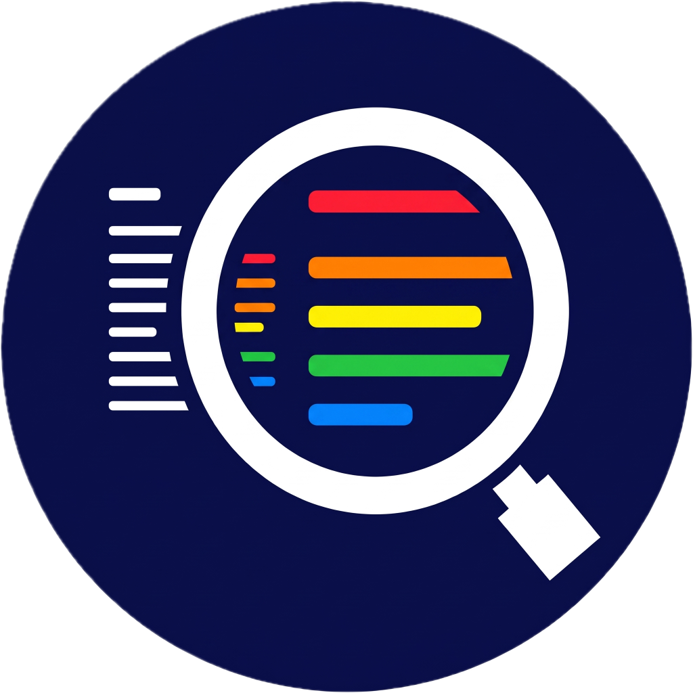

<p align="center">
  
</p>

# OCA Learning Lens

Learning Lens adds a button to Moodle pages so learners can adjust how the live page looks and behaves, without leaving the activity.

Adjustments include:

- Contrast (dark, light, invert, extra)
- Dyslexia-friendly font
- Text spacing
- Highlight links
- Bigger text (125% / 150% / 200%)
- Pause animations
- Hide images (shows available alternative text)
- Reading guide and reading mask
- Read aloud using the browser's built-in speech, with a saved speech speed

Learning Lens does not load remote scripts, does not rewrite page content, and does not claim WCAG or ADA compliance. Read aloud uses the device speech engine only; nothing is sent to a third-party service.

## Requirements

- Moodle 4.5 or 5.0
- No extra plugins or paid subscriptions

## Install

1. Place the plugin folder at `moodle/local/learninglens` (the folder must be named `learninglens`).
2. Visit **Site administration → Notifications** and complete the install.
3. Configure **Site administration → Plugins → Local plugins → OCA Learning Lens**.

You can also install from a ZIP via **Site administration → Plugins → Install plugins**.

From git:

```bash
cd /path/to/moodle/local
git clone https://github.com/opencollegearts/moodle-local_learninglens.git learninglens
```

## Using Learning Lens

- Click the circular button (bottom-left by default) or press **Alt+Shift+A**.
- Toggle or cycle a card. Changes apply immediately and are remembered.
- **Read aloud** plays selected text, or the main page content. Click again to pause or resume. While it is on, click a paragraph to start from there. Press Escape to stop.
- **Reset all** clears adjustments and stops speech.
- Guests: choices stay in this browser.
- Signed-in users: choices also sync to their Moodle account.
- Administrators can hide Learning Lens from a role with the **Use Learning Lens** capability.

## Admin settings

| Setting | Purpose |
|---------|---------|
| Enable Learning Lens | Site-wide master switch |
| Launcher position | Bottom left or bottom right |
| Accessibility statement URL | Optional link in the widget footer |
| Per-feature checkboxes | Hide individual adjustments |

## With Learning Prism

Learning Lens and [Learning Prism](https://github.com/opencollegearts/moodle-local_learningprism) can be used together, but neither requires the other. Learning Prism provides downloadable formats (such as Word, PDF, EPUB, and audio). Learning Lens changes live presentation on the current page.

## Privacy

- No third-party services and no analytics.
- Signed-in users store a small set of presentation choices as a Moodle preference. These are display settings, not a record of disability.
- Guests store the same choices only in the browser.
- The dyslexia-friendly font (OpenDyslexic) is bundled with the plugin.

## Licence

GNU GPL v3 or later. OpenDyslexic is licensed under the SIL Open Font License 1.1.

## Help and feedback

Report problems or suggest improvements at [GitHub Issues](https://github.com/opencollegearts/moodle-local_learninglens/issues).
